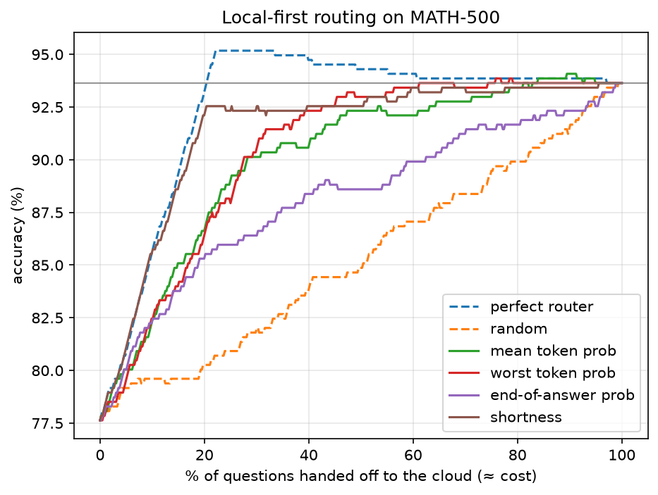
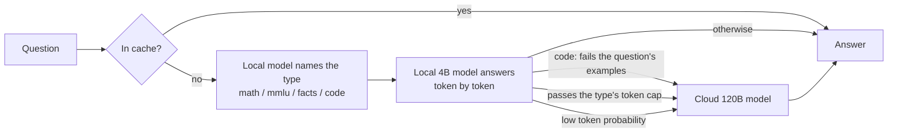

# Local-first LLM router

A 4B model answers on my laptop. When it's likely to be wrong, the question goes to a 120B cloud model instead. The interesting part is the router: **can a small model tell when its own answer is wrong?**

Built on an M5 MacBook Air (16 GB) with [MLX](https://github.com/ml-explore/mlx). Cloud model: `gpt-oss-120b` on Groq.



## Highlights

- **Four question types, one router:** math, multiple choice (MMLU-Pro), facts (TriviaQA) and code (HumanEval), 1,263 questions, every answer checked automatically.
- **Each type gets its own handoff rule**, fitted on one half of the questions and measured on the other. Accuracy on all held-out questions rises from 82.6% (one rule for everything) to 85.8%.
- **The type is detected by the local model itself:** 40/40 on plain hand-written questions and 32/40 on deliberately tricky ones. A TF-IDF classifier scored 97% on benchmark questions but only 15/40 and 12/40 on these, because it had learned the datasets' formatting, not their meaning, so it was dropped.
- **Code is checked by running it** against the examples written in the question. Precision of handoffs goes from 25% to **100%**, and handoffs drop from 56% to **13%**.

## Results across question types

Same two models, four kinds of questions, every answer checked automatically.

| Type | Questions | Local | Cloud | Perfect router | Local time |
| --- | --- | --- | --- | --- | --- |
| Math (MATH-500) | 500 | 78.2% | 93.6% | 95.4% | 42 s |
| Knowledge (MMLU-Pro) | 300 | 66.3% | 78.7% | 83.0% | 35 s |
| Facts (TriviaQA) | 299 | 44.8% | 73.6% | 76.3% | 3.6 s |
| Code (HumanEval) | 164 | 81.7% | 95.7% | 97.0% | 6.2 s |

Code answers are run against HumanEval's unit tests in a sandbox (`router/sandbox.py`).

**How well each confidence signal spots a wrong local answer (AUROC):**

| Signal | Math | MMLU-Pro | Facts | Code |
| --- | --- | --- | --- | --- |
| Answer length | **0.94** | **0.81** | 0.62 | 0.66 |
| Lowest token probability | 0.87 | 0.75 | **0.77** | 0.71 |
| Probability near the end | 0.65 | 0.65 | 0.67 | **0.76** |
| Answers that hit the 2,048-token limit | 21% | 20% | 4% | 2% |

**What this shows:** answer length is a strong warning sign where the model rambles when it's lost (math, MMLU-Pro). For facts and code, wrong answers are as short and confident as right ones, and every simple signal is weak. The 4B model is also far worse at facts (45%) than at code (82%): facts live in parameters, and a 4B model holds far fewer than a 120B one.

## Routing on held-out questions

Each rule: hand off if the answer passes a token cap (checked while generating, so lost answers stop early) or if any token's log-probability falls below a threshold. Both are chosen on the training half and measured on the test half.

- **Precision:** share of handoffs that were needed (the local answer was wrong).
- **Recall:** share of wrong local answers that were caught.

| Type | Test questions | Rule | Accuracy | Precision | Recall | Handed off |
| --- | --- | --- | --- | --- | --- | --- |
| Math | 254 | 600 tokens / −1.5 | 95.3% | 30% | 100% | 60% |
| MMLU-Pro | 142 | 1,100 tokens | 76.8% | 68% | 68% | 35% |
| Facts | 146 | 300 tokens / −0.63 | 73.3% | 59% | 96% | 91% |
| Code (confidence rule) | 86 | 300 tokens / −0.88 | 94.2% | 25% | 75% | 56% |
| **Code (run its examples)** | 86 | fails an example in the question | 93.0% | **100%** | 69% | **13%** |

**All four types together (628 test questions):**

| Version | Accuracy | Precision | Recall | Handed off |
| --- | --- | --- | --- | --- |
| Math's rule for every question | 82.6% | 43% | 77% | 56% |
| Each type's own rule | **85.8%** | 45% | **88%** | 61% |

**What this shows:**
- Per-type rules help mostly by handing off **more** where the local model is weak (facts: 61% → 73% accuracy), not by spotting mistakes better: overall precision only moves from 43% to 45%.
- Confidence signals guess; running the answer checks. For code, every answer that failed its own examples was really wrong. The catch: examples only cover a few cases, so 4 wrong answers passed them (recall 69%).
- For math, facts and multiple choice there is nothing to run, so they still depend on confidence signals. Making those more precise is the job of fine-tuning (next).

### Question-type detection

The gateway needs to know a question's type to pick its rule. Tested on 80 hand-written questions (`router/realistic.py`) phrased the way people actually ask, not like the benchmarks:

| Detector | Plain (40) | Tricky (40) |
| --- | --- | --- |
| TF-IDF + logistic regression, trained on benchmark questions | 15 | 12 |
| Same, plus 32 plain-English examples | 21 | 11 |
| **Local 4B model, asked for the type** (~0.2 s) | **40** | **32** |

Most of the model's misses on the tricky set are debatable ("what's the time complexity of sorted()?" → fact) and land on the fact rule, which hands off almost everything. So a wrong type usually costs an extra cloud call, not a wrong answer.

## How it works



The gateway (`gateway/app.py`) is a FastAPI server with an OpenAI-style endpoint and a small demo page:

- **Type first:** the local model names the question's type (or the caller passes `task`), which picks the routing rule.
- **Local first:** runs the 4B model with MLX and watches each token as it's generated.
- **Code is executed:** a code answer is run in the sandbox against the examples in the question.
- **Early stop:** if the answer passes the token cap, it stops and hands off instead of waiting.
- **Cache:** repeated questions are answered from SQLite at no cost.
- **Cost tracking:** cloud calls are priced at Groq's rates ($0.15 / $0.60 per million input / output tokens); local answers log what the cloud would have cost.
- **Transparency:** every response says where the answer came from and why.

```json
"router": {
  "task": "math",
  "task_source": "detected by local model",
  "route": "cloud",
  "reason": "local answer passed 600 tokens",
  "local_tokens": 601,
  "cost_usd": 0.000076,
  "latency_s": 13.82
}
```

## Run it

Needs an Apple Silicon Mac, [uv](https://docs.astral.sh/uv/), and a free [Groq API key](https://console.groq.com).

```bash
uv sync
export GROQ_API_KEY="your-key"

# reproduce the results
uv run python router/stage1_baseline.py local --task math --n 500
uv run python router/stage1_baseline.py cloud --task math --n 500
uv run python router/stage2_router.py score  --task math
uv run python router/stage2_router.py report --task math
uv run python router/fit_config.py --task math
# (repeat with --task mmlu / trivia / code)

uv run python router/compare.py              # one rule vs per-type rules
uv run python router/code_examples.py        # code: run answers against the question's examples
uv run python router/realistic.py --hard     # question-type detection

# start the gateway, then open http://127.0.0.1:8000 for the demo page
# (or /docs to try the raw API)
uv run uvicorn gateway.app:app --port 8000
```

| File | What it does |
| --- | --- |
| `router/tasks.py` | Question types: how each is loaded, prompted and checked (math, MMLU-Pro, TriviaQA, code) |
| `router/sandbox.py` | Runs model-written code against unit tests, with a timeout and resource limits (optional Docker mode) |
| `router/stage1_baseline.py` | Runs both models on a task and checks answers |
| `router/stage2_router.py` | Scores confidence signals; AUROC, cost–accuracy curves, held-out test |
| `router/fit_config.py` | Picks a type's rule on the training split, reports precision/recall on the test split |
| `router/compare.py` | One rule for everything vs each type's own rule |
| `router/code_examples.py` | Extracts the examples from a coding question and runs the answer against them |
| `router/realistic.py` | Hand-written plain and tricky questions for testing type detection |
| `gateway/app.py` | The API server |
| `gateway/static/index.html` | Demo page: ask a question, see where it was answered and why |
| `results/<task>/` | Raw outputs, signals, chosen rule, chart, per question type |

## Limitations

- **Benchmarks, not real traffic.** Rules were fitted on benchmark questions; real users ask differently, as the type-detection test showed.
- **The cloud is faster here.** Groq answers in about 2 s; the 4B model on a MacBook Air takes 4–43 s depending on the type. The case for local-first is cost and privacy, not speed.
- **Handoffs improve the odds, not certainty.** The cloud model is wrong too: 6% on math, 26% on facts.
- **Small test splits** (86–254 questions per type). Differences of a point or two are within noise.
- **The type-detection questions were written by me**, 80 of them. Treat 32/40 as indicative, not precise.
- **Time savings from early stop are estimated** from token counts, assuming time grows evenly with tokens.
- **The default code sandbox is not a security boundary.** It uses a separate process, a timeout and a throwaway folder; on macOS the memory limit isn't enforced. `SANDBOX=docker` runs code in a container with no network, a read-only file system and a memory limit.

## Next

1. **Fine-tune** the 4B model to say when it should hand off, instead of inferring it from token probabilities afterwards.
2. **Reinforcement learning** with a reward that penalizes unnecessary handoffs and confidently wrong answers.
3. Compare against a calibrated-threshold router ([UCCI, 2026](https://arxiv.org/abs/2605.18796)), and serve with vLLM for throughput numbers.
