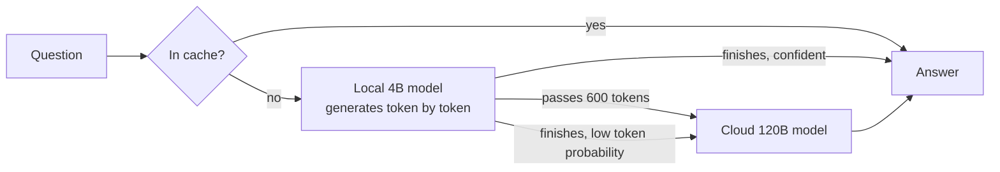

# Local-first LLM router

A 4B model answers on my laptop. When it's likely to be wrong, the question goes to a 120B cloud model instead. The interesting part is the router: **can a small model tell when its own answer is wrong?**

Built on an M5 MacBook Air (16 GB) with [MLX](https://github.com/ml-explore/mlx). Cloud model: `gpt-oss-120b` on Groq.


## Results

Data: 456 problems from [MATH-500](https://huggingface.co/datasets/HuggingFaceH4/MATH-500), difficulty levels 1–5. Answers are checked automatically with [Math-Verify](https://github.com/huggingface/Math-Verify).

| | Accuracy | Time per question |
| --- | --- | --- |
| Local: Qwen 3.5 4B, 4-bit, on the Mac | 77.6% | 43 s |
| Cloud: gpt-oss-120b on Groq | 93.6% | 1.9 s |
| Perfect router (upper bound) | **95.2%** | — |

The local model is wrong but the cloud right on 80 questions; the reverse happens on 7. So a perfect router would **beat the cloud** while sending out only the ~22% of questions the local model gets wrong.

### How good are simple confidence signals?

Each signal is scored by AUROC: the chance that a random correct answer gets higher confidence than a random wrong one (0.5 = coin flip, 1.0 = perfect).

| Signal | AUROC |
| --- | --- |
| Answer length (shorter = more confident) | **0.94** |
| Lowest token probability in the answer | 0.87 |
| Mean token probability | 0.82 |
| Token probability near the final answer | 0.65 |

Answer length works well for a concrete reason: **21% of local answers ran into the 2,048-token limit.** When the model gets lost, it keeps writing.

### The router in the gateway (held-out test)

Rule: hand off if the answer passes **600 tokens** (checked while generating, so lost answers stop early) or if any token's log-probability is below **−1.5**. Thresholds were chosen on one half of the questions and measured on the other 236.

| Metric | Router | Perfect router |
| --- | --- | --- |
| Accuracy | 94.9% (cloud alone: 94.5%) | — |
| **Recall:** share of local mistakes caught | **100%** | 100% |
| **Precision:** share of handoffs that were needed | **31%** | 100% |
| Questions handed off | 61% | 19% |
| Local compute time saved by early stop (estimated) | 40% | — |

**The honest summary:** simple signals catch every local mistake, but only about 1 in 3 handoffs is necessary. The rules are cautious, not precise. Raising precision while keeping recall near 100% is the goal of the next stages.

## How it works



The gateway (`gateway/app.py`) is a FastAPI server with an OpenAI-style endpoint:

- **Local first:** runs the 4B model with MLX and watches each token as it's generated.
- **Early stop:** if the answer passes the token cap, it stops and hands off instead of waiting.
- **Cache:** repeated questions are answered from SQLite at no cost.
- **Cost tracking:** cloud calls are priced at Groq's rates ($0.15 / $0.60 per million input / output tokens); local answers log what the cloud would have cost.
- **Transparency:** every response says where the answer came from and why.

```json
"router": {
  "route": "cloud",
  "reason": "local answer passed 600 tokens",
  "local_tokens": 601,
  "cost_usd": 0.000076,
  "latency_s": 13.82
}
```

## Run it

Needs an Apple Silicon Mac, [uv](https://docs.astral.sh/uv/), and a free [Groq API key](https://console.groq.com).

```bash
uv sync
export GROQ_API_KEY="your-key"

# reproduce the results
uv run python router/stage1_baseline.py local --n 500
uv run python router/stage1_baseline.py cloud --n 500
uv run python router/stage2_router.py score
uv run python router/stage2_router.py report
uv run python router/fit_config.py

# start the gateway, then open http://127.0.0.1:8000/docs
uv run uvicorn gateway.app:app --port 8000
```

| File | What it does |
| --- | --- |
| `router/stage1_baseline.py` | Runs both models on MATH-500 and checks answers |
| `router/stage2_router.py` | Scores confidence signals; AUROC, cost–accuracy curves, held-out test |
| `router/fit_config.py` | Picks the gateway's rule on a training split, reports precision/recall on the test split |
| `gateway/app.py` | The API server |
| `results/` | Raw outputs, signals, chosen rule, chart |

## Limitations

- **Math only.** Thresholds were tuned on MATH-500 with a math system prompt. Routing for other kinds of questions isn't validated.
- **The cloud is faster here.** Groq answers in about 2 s; the 4B model on a MacBook Air takes about 43 s. The case for local-first is cost and privacy, not speed.
- **Handoffs improve the odds, not certainty.** The cloud model is wrong on about 6% of these problems too.
- **One test split of 236 questions.** Small differences between rules are within noise.
- **Time savings from early stop are estimated** from token counts, assuming time grows evenly with tokens.

## Next

1. **Fine-tune** the 4B model to say when it should hand off, instead of inferring it from token probabilities afterwards.
2. **Reinforcement learning** with a reward that penalizes unnecessary handoffs and confidently wrong answers.
3. Compare against a calibrated-threshold router ([UCCI, 2026](https://arxiv.org/abs/2605.18796)), and serve with vLLM for throughput numbers.
